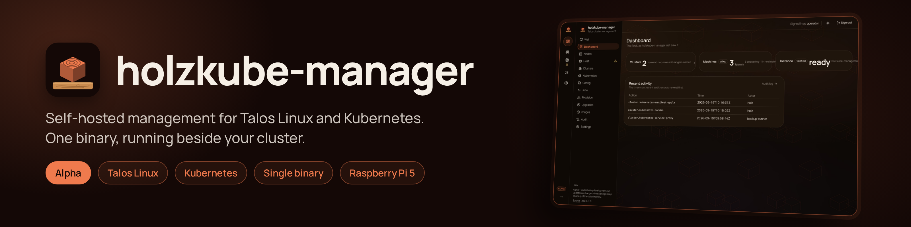
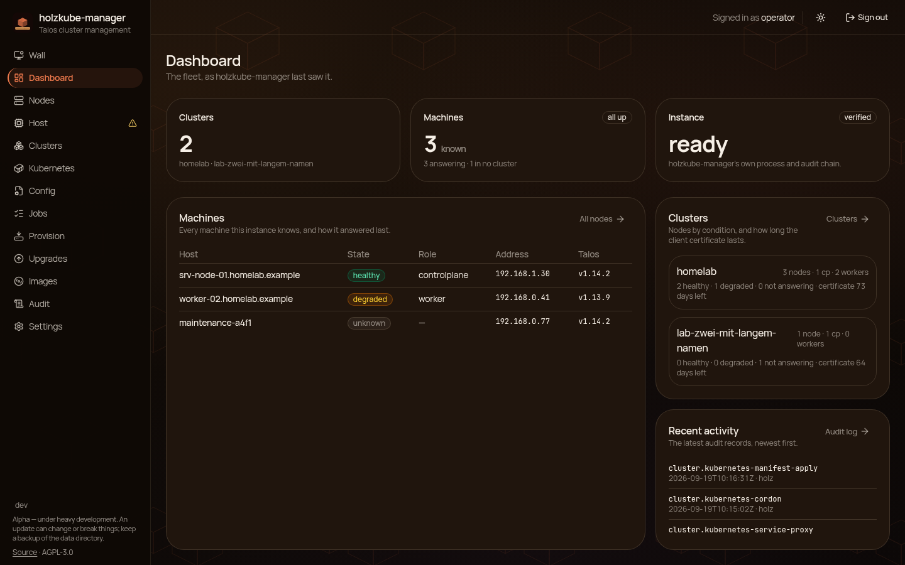
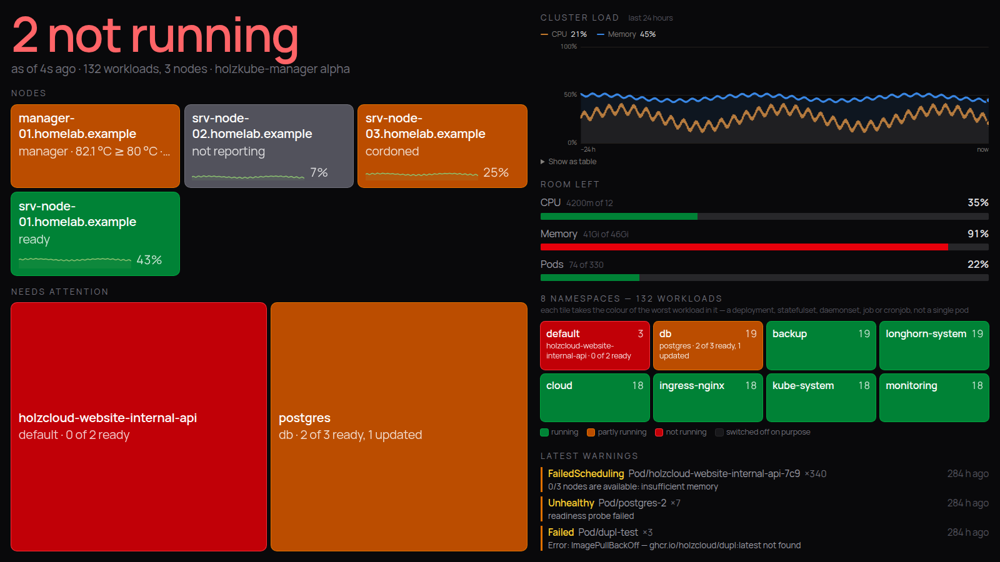
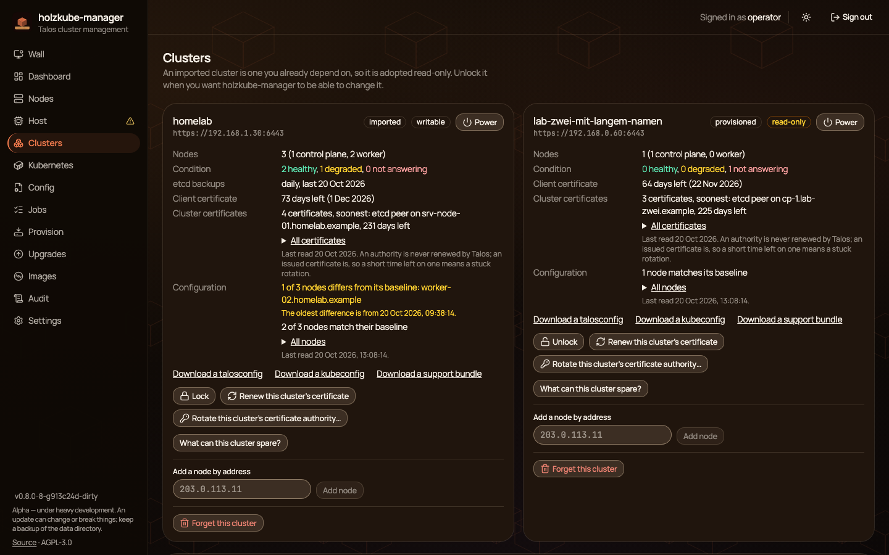
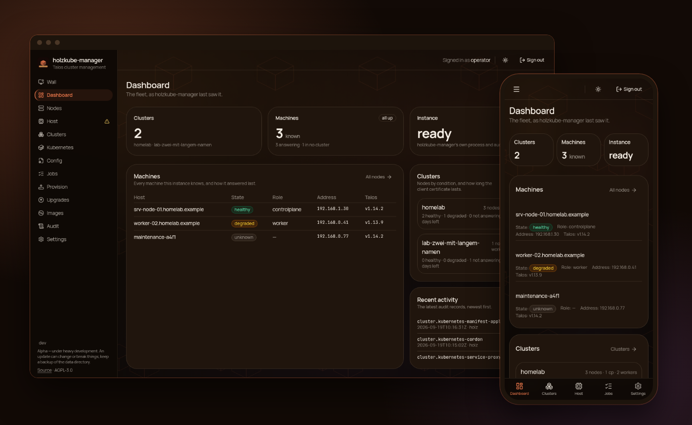

<p align="center">
  
</p>

<p align="center">
  
  <a href="https://github.com/holzcloud/holzkube-manager/releases"></a>
  <a href="https://github.com/holzcloud/holzkube-manager/actions/workflows/ci.yml"></a>
  
  
  <a href="LICENSE"></a>
  <a href="https://github.com/sponsors/holzcloud"></a>
</p>

<p align="center">
  <b><a href="https://holzcloud.ch/holzkube-manager">Project page</a></b> ·
  <a href="docs/guide.md">Guide</a> ·
  <a href="https://github.com/holzcloud/holzkube-manager/releases">Releases</a>
</p>

**holzkube-manager** is a self-hosted web interface for
[Talos Linux](https://www.talos.dev) and the Kubernetes clusters on top of it,
and a lightweight alternative to Sidero Omni for a homelab or a small site. It
is a single Go binary with the interface compiled in. It runs beside the
cluster, not in it, so a Raspberry Pi on the same network is enough. It talks to
the Talos machine API and the Kubernetes API directly and shows what the cluster
just said, nothing cached or guessed.

> [!WARNING]
> **Alpha software under heavy development.** Any release can change or remove
> features, the API and the data directory format, and an update can break
> things. Back up the data directory (see the
> [guide](docs/guide.md#backups)) and read the release notes before updating.



## What it does

- **Cluster management:** adopt an existing Talos cluster from its talosconfig
  or provision a new one, and follow nodes as they join or leave.
- **Live node hardware:** load per core, temperatures, fans, memory, disks and
  network, with 24 hours of history kept across restarts.
- **Kubernetes:** workloads, pods and why one is broken, events, storage,
  networking, cordon and drain, apply a manifest, run a command in a container.
- **Upgrades:** Talos upgrades built from Image Factory schematics, one node at
  a time behind an etcd health gate, and never without a fresh etcd snapshot.
  Kubernetes upgrades follow the order of `talosctl upgrade-k8s`.
- **etcd backup and restore:** snapshots on a schedule (every 6 hours, daily or
  weekly), with download, checksum and an "overdue" warning.
- **Certificates and security:** certificate expiry read from the cluster and
  warned about, SecureBoot and disk encryption, local account plus OIDC single
  sign-on, roles, re-authentication before destructive actions, a hash-chained
  audit log, and a `--dry-run` mode that refuses every change.
- **Configuration drift:** the active configuration of every node is read every
  few hours and compared with what holzkube-manager last knew or set itself. A
  change made at the node (talosctl, another operator) shows up with its diff on
  the node page, as a row on the cluster card and in `/metrics`, and as a banner
  once it has stayed unconfirmed for a day; "this is intended" makes the new
  state the baseline and changes nothing on the node.
- **Power:** stop, start or restart a cluster, a node or an app; Wake-on-LAN
  brings a node back.
- **The host itself:** a Host page for the machine it runs on, with live CPU,
  memory, disks and temperatures, and a self-update that rolls back if the
  service does not answer afterwards.
- **Around it:** a wall view for an office screen, a phone-friendly interface,
  Prometheus `/metrics`, a support bundle and the `holzkubectl` command line.

## A look around







## Install

Download the `linux_arm64` archive from the
[newest release](https://github.com/holzcloud/holzkube-manager/releases)
(builds are for the Raspberry Pi 5 only for now), then:

```sh
tar xzf holzkube-manager_*_linux_arm64.tar.gz
./holzkube-managerd
```

Open `https://<host>:8443` and create the first account in the browser. The
certificate is self-signed; compare the fingerprint in your browser with the
`sha256_fingerprint` line in the log before accepting it. To run it as a service
with hourly updates, a container, or from source (Go 1.26 and Node, `task
build`), follow the [guide](docs/guide.md).

## Documentation

- [Guide](docs/guide.md): building, running, configuring and operating
- [API contract](docs/api-contract.md): routes, errors, CSRF and the audit query
- [talossim](docs/talossim.md): the in-process Talos node the tests run against
- [Contributing](CONTRIBUTING.md) and [security](SECURITY.md)

## Licence

Free software under the [GNU Affero General Public License v3](LICENSE) (AGPL-3.0).
Running it on your own cluster obliges you to nothing; if you offer a modified
version to other people over a network, they are entitled to your changes.
